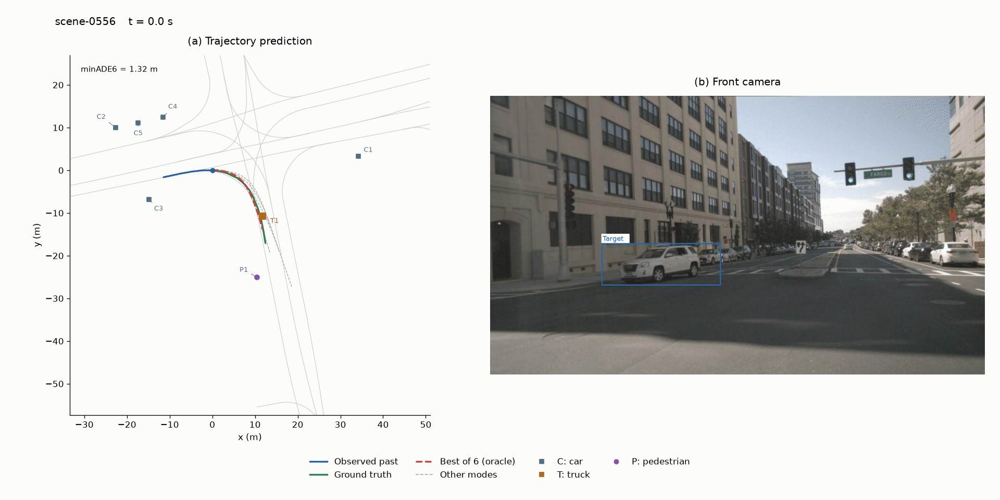

# Multimodal Trajectory Prediction with a GRU Decoder

Predicting how a vehicle will move means accounting for several plausible futures. This project studies what graph-based interactions, lane geometry, and sequential decoding each contribute to that prediction on **nuScenes**.

The final model combines a **GATv2 interaction backbone**, a **lane-centerline map encoder**, and a **GRU displacement decoder**. It uses 2 seconds of observed motion to predict **six possible trajectories over the next 6 seconds**.

**[Read the report](report/Trajectory_prediction_Report.pdf)**

<p align="center">
  
</p>

*Right-turn prediction on nuScenes. Red highlights the mode closest to ground truth by ADE.*

## What we found

Lane context gives the clearest gain over the model without maps. Replacing the one-shot MLP decoder with a GRU improves predictions further, especially on turns.

The matched decoder comparison uses **seeds 42, 123 and 2026**, **60 epochs**, and standard unweighted sampling. Values are full-test means ± population standard deviations across seeds; lower is better.

| Map-aware decoder | minADE₆ [m] | minFDE₆ [m] |
|---|---:|---:|
| One-shot MLP | 1.533 ± 0.003 | 3.121 ± 0.012 |
| GRU displacement | 1.474 ± 0.016 | 2.931 ± 0.044 |

The GRU reduces overall minADE₆ by **3.8%** and minFDE₆ by **6.1%**. For 30–60° endpoint-angle trajectories, minFDE₆ improves by **18.1%**. Sharp turns remain difficult, and removing neighbors has little effect on the final model. The report covers these diagnostics and limitations.

## How it works

The model combines agent motion histories and one-hot category encodings with nearby lane geometry. GATv2 models agent interactions, while a GRU predicts six possible future trajectories step by step. See the [report](report/Trajectory_prediction_Report.pdf) for the architecture, training procedure, and evaluation.

## Repository

```text
assets/       right-turn demo and sequence metadata
report/       project report
scripts/      dataset preparation, training and evaluation
utils/        models, graph construction and training utilities
tools/        qualitative prediction and sequence plots
```

This project was developed as a final project for the DIT968 Deep Machine Learning course at Chalmers.
