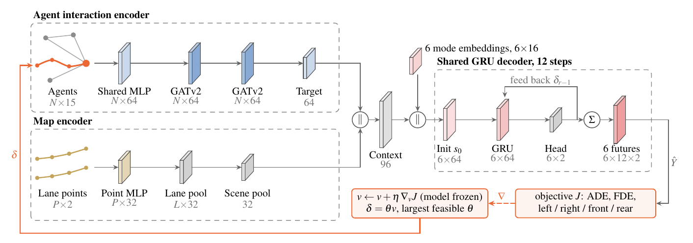

# GNN trajectory prediction

This project predicts the future motion of road users on the nuScenes dataset. For each target agent, the model takes 2 s of past positions and predicts its next 6 s (using 2 Hz). The predictor is a graph neural network (GNN): the target and its nearby road users form a graph, and GATv2 attention passes information between them. This differs from the Transformer-based models that lead most current trajectory-prediction benchmarks.

## Contents

1. [Model Architecture](#model-architecture)
2. [Final matched decoder result](#final-matched-decoder-result)
3. [Robustness evaluation](#robustness-evaluation)
4. [Setup and data](#setup-and-data)
5. [Train the final model](#train-the-final-model)
6. [Evaluate and analyze saved weights](#evaluate-and-analyze-saved-weights)
7. [Run the adversarial attack](#run-the-adversarial-attack)
8. [Repository layout](#repository-layout)

## Model Architecture



*Fig. 1 from the [report](doc/report/report.pdf), with tensor sizes under each layer. Orange marks the adversarial attack studied in the report, which changes only the target's past positions.*

Like most trajectory predictors, the model has three parts:

1. **Agent history encoder.** Each agent, the target and every vehicle or pedestrian within 35 m, is a graph node. Its input is its 5 past positions in the target's frame plus a 5-class category one-hot (15 features). A shared linear layer with ReLU maps this to a 64-D embedding. With only 5 fixed points, no recurrent encoder is needed.
2. **Neighbour encoder.** All nodes are fully connected by directed edges whose features are the current relative position `[dx, dy, distance]`. Two GATv2 layers let each node attend to the others, and the target's 64-D output is kept. Nearby lane centrelines are encoded separately as point sets (a point MLP, then max-pooling within each lane and across lanes) into a 32-D map vector, which joins the target embedding in a 96-D context.
3. **Multimodal decoder.** Six learned 16-D mode embeddings, each combined with the context, initialise a shared 64-D GRU. For 12 steps, the GRU predicts a displacement and feeds it back; the displacements are summed into six candidate 6 s trajectories. Training uses the best-of-six ADE loss, so only the closest candidate is trained on each sample.

## Final matched decoder result

Seeds 42, 123 and 2026; 60 epochs, standard unweighted sampling, best validation-loss checkpoint. Errors are metres; standard deviations are population values across seeds.

| Map-aware decoder | Test minADE6 | Test minFDE6 |
|---|---:|---:|
| One-shot MLP | 1.532545 ± 0.003414 | 3.121037 ± 0.012009 |
| GRU displacement | **1.474151 ± 0.016075** | **2.930938 ± 0.044113** |

GRU improves overall ADE/FDE by **3.81% / 6.09%**. Gains at 30–60° endpoint angles are **11.62% / 18.08%**, and at 60°+ **6.38% / 7.59%**. Sharp-turn errors remain high. The sharpest bin has 87 samples, and three seeds do not provide scene-level confidence intervals.

See the [canonical comparison](doc/results/final_decoder_multiseed_comparison.md), [machine-readable results and manifests](doc/results/final_decoder_multiseed_comparison.json), [final figure](doc/figures/final_decoder_multiseed_comparison.png), and [diagnostic chain](doc/results/diagnostic_summary.md). The canonical artifacts preserve the pre-cleanup experiment snapshot; use the commands below for the frozen interface.

## Robustness evaluation

We test the model with the adversarial attack of [Zhang et al. (CVPR 2022)](https://arxiv.org/abs/2201.05057), adapted to six-candidate prediction ([code](scripts/adversarial_attack.py)).

1. **The perturbation is on the trajectory.** The attacker drives the target vehicle along a slightly changed path, so a perturbation is added only to the target's 5 observed positions. Neighbours and lanes stay fixed. Each point moves at most 1 m, and the changed history must stay within the nuScenes physical limits on speed, acceleration and jerk.
2. **PGD generates it** (orange loop in Fig. 1). With the model frozen, the perturbation follows the gradient of an attack objective for 100 steps, from 10 random starts. After each step it is scaled down until it is physically feasible. The objective is either the overall error (ADE or FDE) or the shift of the prediction to the left, right, front or rear.
3. **Metrics.** minADE6 and minFDE6, clean and attacked, plus the share of predictions pushed more than 1.85 m (half a lane) in the attacked direction. As a control, a random perturbation of the same size is applied. All models are attacked on the same 500 validation samples, with 3 seeds each.

Results (see the [report](doc/report/report.pdf) for details):

- **The attack is effective.** A mean shift of only 0.18 m per point roughly doubles the error: minADE6 rises from 1.46 to 2.82 m and minFDE6 from 3.03 to 6.01 m. The share of predictions more than half a lane off rises from 4% to 33%. Random noise of the same size changes minADE6 by only 0.02 m, so the direction of the shift matters, not its size.
- **The lane map makes the model more robust.** Adding the map to the six-mode GATv2 lowers lateral attack success from 38% to 21% and longitudinal success from 68% to 49%. The attacker can change the target's path but not the road layout.

## Setup and data

Create the environment ([details](instructions/01_environment_setup.md)), for example on Linux:

```bash
conda env create -f conda-environment-files/conda-environment-cpu-unix.yml
conda activate gnn_trajectory
```

The final experiments ran on Python 3.12.3, PyTorch 2.14.1 and PyG 2.8.0.post1, newer than the Conda files, so reruns may differ slightly.

Map-aware training needs `data/processed/nuscenes_{train,val,test}_prediction_samples_map.pkl`, which are not in Git. To build them, place nuScenes v1.0-trainval and the map expansion under `data/` and run from the project root:

```bash
python scripts/build_processed_dataset.py
```

Local train/val/test are the official prediction splits train/train_val/val, not the challenge test split. Lanes are taken within 50 m of the target.

## Train the final model

```bash
python scripts/train_model.py --model multimodal_map_gru \
  --seed 2026 --epochs 60 --batch-size 64 --lr 0.001 \
  --checkpoint-dir checkpoints_final_gru/seed2026
```

Other models: `target_mlp`, `attention`, `multimodal` and `multimodal_map`. The best validation checkpoint is kept with a manifest beside it, and existing checkpoints are never overwritten. Defaults are seed 42 and 30 epochs.

## Evaluate and analyze saved weights

Checkpoints are kept locally, not in Git.

```bash
CKPT=checkpoints_gru_decoder/multimodal_map_gru_seed2026_best.pth

# Test metrics only, no training
python scripts/train_model.py --model multimodal_map_gru --evaluate-only --checkpoint $CKPT
# Error by endpoint turn angle
python scripts/run_turn_angle_analysis.py --checkpoint $CKPT
# MLP vs GRU decoder over all six checkpoints
python scripts/compare_decoder_multiseed.py
# Target-only MLP vs GATv2 by neighbour count and distance
python scripts/run_interaction_analysis.py
# Plot all six predicted modes for test sample 6706
python tools/plot_qualitative_prediction.py --sample-index 6706 --show
```

These commands print or show results without writing files. To save, add `--output` with a new file path (for the plot, also drop `--show`); existing files are never overwritten.

## Run the adversarial attack

```bash
# Attack the final model (seed 42) on 500 validation samples with all six objectives
python scripts/adversarial_attack.py --models multimodal_map_gru:42 --tag _map_gru_seed42
# Combine the runs of several seeds into one report
python scripts/adversarial_attack.py --tag _map_gru \
  --merge data/processed/adversarial/results_val_b3_map_gru_seed*.json
```

Models are given as `<model>:<seed>`, or `cv` for constant velocity. The checkpoint `<model>_seed<seed>_best.pth` is looked up in `checkpoints/`, `checkpoints_60ep/` and `checkpoints_gru_decoder/`; use `--checkpoint-dir` for others. Results (JSON and Markdown) and per-sample perturbations go to `data/processed/adversarial/`, example plots to `doc/figures/adversarial/`. Use `--num-samples 100` for a quick check.

## Repository layout

```text
scripts/     dataset building, common training/evaluation, final analyses
utils/       model definitions, graph conversion, loss/training, analysis/provenance
notebooks/   retained exploratory/teaching history; generated outputs cleared
tools/       camera and processed-sample inspection helpers
doc/results/ canonical decoder comparison, diagnostic summary and freeze audit
doc/figures/ final matched decoder figure
```

`run_radius_sweep.py` remains as the historical reproduction entry point for the [35 m selection](doc/radius_sweep_results.md); no new sweep is needed. Exploratory notebooks retain earlier GINE/radius-graph and historical FDE conventions where labelled. Use scripts for final results. The [freeze audit](doc/results/repository_freeze.md) records retained/retired files, notebook findings and validation.
