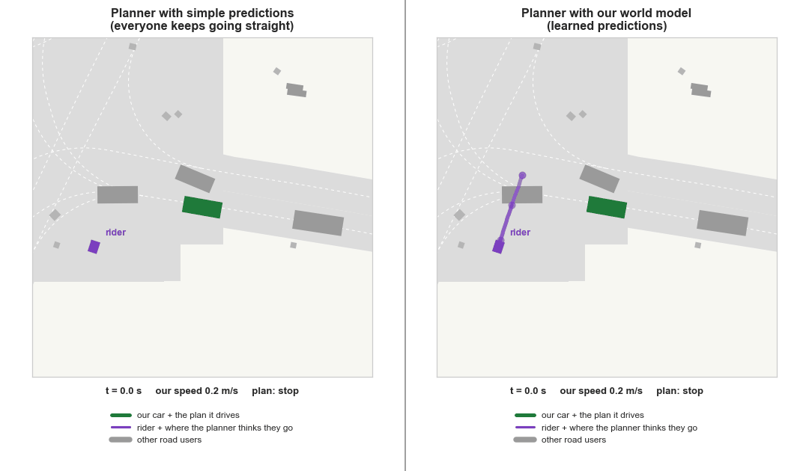
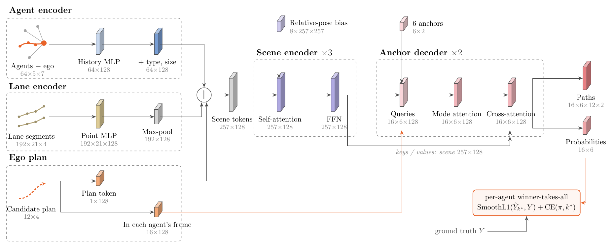
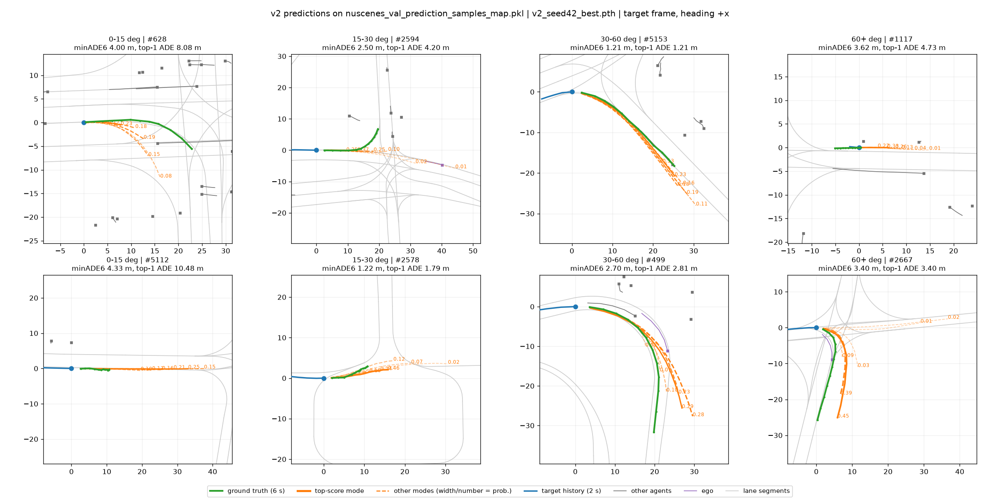
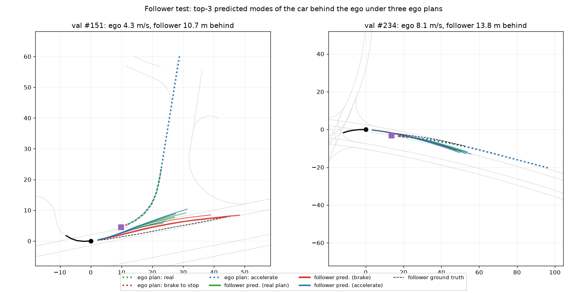

# A trajectory-prediction world model for closed-loop planning

A scene transformer, trained on [nuScenes](https://www.nuscenes.org/nuscenes), predicts where nearby road users will
go in the next 6 s, given the plan our car is considering. A planner in [MetaDrive](https://github.com/metadriverse/metadrive)
uses those predictions to pick a safe plan every 0.5 s.

### Same street scene, two planners

Our car (green) re-plans every 0.5 s.
- **Left:** it assumes everyone keeps going straight at the same speed.
- **Right:** it asks the learned world model.

Watch the rider (purple).

<p align="center">
  
</p>

*Left: the conflict is seen only 0.2 s ahead, and the car hits the rider. Right: the rider's move is predicted early;
the car slows down and passes. (nuScenes mini scene-1094, a development scene; other road users react to our car.)*

<p align="center">
  
</p>

## Results

On **146 held-out test scenes**, the same planner is run with constant-velocity predictions (CV) and with the world
model (WM). Other road users either replay the log or react to our car.

| Planner | Other road users | At-fault collisions | Rear-ended | Progress | Time within 1 m of others |
|---|---|---|---|---|---|
| CV | replay the log | 1 | 14 | 0.921 | 10.7% |
| WM | replay the log | 0 | 16 | 0.923 | 6.0% |
| CV | react | 1 | 2 | 0.917 | 8.3% |
| WM | react | **0** | 2 | 0.917 | **3.6%** |

The decision rule was pre-registered. **The world-model planner is safer:** it spends 4.7 percentage points less time
within 1 m of others (97.5% CI [−8.0, −2.1] pp, p = 1e-4), with the same progress.

Open-loop prediction error (val, target minADE₆) is 1.239 ± 0.006 m over 3 seeds. Every run is listed in
[docs/EXPERIMENTS.md](docs/EXPERIMENTS.md).

<details>
<summary>More figures</summary>

<p align="center"></p>

*Open-loop predictions on val. Green: what happened; orange: the 6 predicted futures (number = probability).*

<p align="center"></p>

*The car behind ours is predicted to slow down when we plan to brake (red), and to speed up when we accelerate (blue).*

</details>

## Limitations

- **Few at-fault events.** There is only 1 at-fault collision in 146 scenes, so the safety result rests on the
  close-call measure. That measure was made a primary endpoint after an earlier test run had been seen; this is
  disclosed in docs/EXPERIMENTS.md.
- **Limited coverage.** The model predicts 16 road users; the remaining ~15% nearby fall back to constant velocity.
- **Simple reactive road users.** Only cars and trucks react, there is no merge anticipation, and pedestrians and
  cyclists replay the log.
- **Weak reaction to our plan.** The predicted reaction to our plan is weaker than real drivers'.

<details>
<summary>Reproduce</summary>

Put the nuScenes v1.0-trainval metadata and the map expansion v1.3 in `data/`. For the simulator, add the `v1.0-mini`
tables in `data/nuscenes_mini/v1.0-mini/` and link the maps with `ln -s ../maps data/nuscenes_mini/maps`.

```bash
# environments: .venv (training), .venv_sim (simulator)
python3.12 -m venv .venv && .venv/bin/pip install -r requirements.txt scikit-learn scipy openpyxl
uv venv --python 3.10 .venv_sim
git clone --depth 1 https://github.com/metadriverse/metadrive.git sim/metadrive
git clone --depth 1 https://github.com/metadriverse/scenarionet.git sim/scenarionet
VIRTUAL_ENV=.venv_sim uv pip install -e sim/metadrive -e sim/scenarionet "nuscenes-devkit>=1.1.10" ijson
VIRTUAL_ENV=.venv_sim uv pip install torch --index-url https://download.pytorch.org/whl/cu132
.venv_sim/bin/python -m metadrive.pull_asset

# dataset (~20 min) and training
.venv/bin/python scripts/build_processed_dataset.py --lane-tokens --workers 6
FLAGS="--model v2 --predict-agents 16 --ego-plan --target-split --plan-queries --plan-drop 0.2"
.venv/bin/python scripts/train_model.py $FLAGS --assign predicted --epochs 60 --patience 15 --patience-start 30 \
    --batch-size 64 --lr 0.001 --seed 42 --checkpoint-dir checkpoints/v2_d_rerun

# validation
.venv/bin/python scripts/train_model.py $FLAGS --evaluate-only --checkpoint checkpoints/v2_d_rerun/v2_seed42_best.pth

# closed loop: convert scenes, check on the mini dev scenes, then the final test (replay and reactive)
.venv_sim/bin/python scripts/sim_check.py convert --scenes 10
.venv_sim/bin/python scripts/sim_check.py convert --set test150 --scenes 146
.venv_sim/bin/python scripts/sim_check.py evaluate --data sim/scenarios/nuscenes_mini --out outputs/sim/mini_check
.venv_sim/bin/python scripts/sim_check.py evaluate --data sim/scenarios/nuscenes_test150 --out outputs/sim/test150_v4
.venv_sim/bin/python scripts/sim_check.py evaluate --data sim/scenarios/nuscenes_test150 --reactive idm \
    --out outputs/sim/test150_reactive
```

</details>

## Repository

- `utils/`: the dataset and the model (`models_v2.py`).
- `scripts/`: data building, training, open-loop analysis and the simulator entry point (`sim_check.py`).
- `sim/`: the planner, the simulator-to-model adapter and the reactive road users.

Details are in [docs/CODE_GUIDE.md](docs/CODE_GUIDE.md). The earlier GNN model (v1, a final project for SSY340 at
Chalmers) is on branch `feature/trajectory-prediction`.
